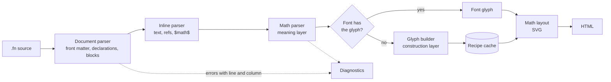

<p align="center"></p>

# Functor

Functor is a typesetting language for mathematics. It builds symbols from a small grammar. You do not memorise a long list of commands.

```text
$$
sum.circle_(k = 1)^n a_k = integral.x2_D f d x d y,   x in.not A,   theta.hat
$$
```

`sum.circle` is a sum in a circle. `in.not` is "not in". `theta.hat` is an estimate of theta. One base, then short operations.

## Status

Phase 0. The compiler, the glyph builder and the compile website work. Some parts come in phase 1: own kinds, `deform`, `fuse`, `stretch`, packages and page layout for print.

## Use the website

The website has an editor at the left and a live preview at the right. It runs the compiler in your browser as WebAssembly. No server is necessary.

- Type in the editor. The preview changes at each key.
- Errors show in the editor and in the problem list. Click a problem to go to its line.
- Type `.` after a symbol in math to see the operations. Each one shows its meaning and a preview of the glyph.
- **Save .fn** downloads your file. **Open** loads a file. **HTML** downloads the compiled page. **PDF** opens the print dialog.
- The website keeps your last file in this browser.

Run it on your computer:

```sh
rustup target add wasm32-unknown-unknown
cd web
npm install
npm run dev
```

## Use the desktop app

The desktop app is the same editor in a native window. The compiler runs as native Rust, not WebAssembly.

```text
 .fn file on disk ──► editor (web/) ──► functor-core (native) ──► preview
        ▲                                      │
        └────────── watch: reload on change ◄──┘
```

- **Open** (Ctrl+O) opens a `.fn` file from disk. **Save** (Ctrl+S) writes it back. Shift+Save is "Save as".
- When another program changes the open file, the app loads the new text. It does not do this when you have unsaved changes.
- The app opens your last file at start. You can also give a path: `functor-desktop notes.fn`.
- It works with no network.

Run it on your computer (Linux needs `libwebkit2gtk-4.1-dev`):

```sh
rustup target add wasm32-unknown-unknown
(cd web && npm install)
cd desktop
npm install
npm run dev
```

`npm run build` makes an installer in `desktop/target/release/bundle`. The **Desktop** workflow on GitHub makes installers for Linux, macOS and Windows.

## Use the command line

```sh
cargo run -p functor-cli -- compile examples/sample.fn
cargo run -p functor-cli -- check examples/sample.fn
cargo run -p functor-cli -- glyph sum.circle > sum-circle.svg
cargo run --release -p functor-cli -- bench examples/sample.fn
```

`check` writes each problem as `file:line:col: error: message`, with a hint below it.

## The language in one page

```text
---
functor: 1
title: Notes on fields
author: E
---

object vec: F, v
sym csum = sum.circle
set vec(style: arrow)
let n = 3

# Fields {#sec:fields}

A force $F = m a$ acts on {n} bodies. See @eq:work.

$$
W = csum_C F cdot d r
$$ {#eq:work}

::: theorem {#thm:main title="Closed work"}
If $F = nabla phi$, then $W = 0$.
:::

::: proof
Use @eq:work.
:::
```

| Part | Form | Result |
|:--|:--|:--|
| Version | `functor: 1` in the front matter | The compiler knows which language rules to use |
| Heading | `# Text {#label}` | Numbered heading |
| Inline math | `$x.hat$` | Math in the line |
| Display math | `$$ ... $$ {#eq:name}` | Numbered equation |
| Reference | `@eq:name` | "(1)", "Theorem 2", "Section 3" |
| Block | `::: theorem {#thm:a title="..."}` ... `:::` | theorem, lemma, corollary, proposition, definition, example, remark, proof, note, figure, quote |
| Object | `object vec: F, v` | `F` and `v` are vectors. Their look comes from `set vec(...)` |
| Symbol | `sym csum = sum.circle` | A short name for a recipe |
| Value | `let n = 3`, then `{n}` in text | Text replacement |
| Punctuation | `"text"`, `'text'`, `--`, `---`, `Theorem~2` | Curly quotes, en dash, em dash, a space that does not break. `\"`, `\'`, `\-`, `\~` give the plain sign |
| Setting | `set page(size: a4)`, `set text(size: 11pt)`, `set heading(numbering: none)` | Document settings |

Functor sets each paragraph itself, as TeX does. It shapes words with the font (kerning and ligatures), finds hyphenation points with TeX patterns, and picks the line breaks for the whole paragraph with the Knuth-Plass method. Inline math can break after `=`, `<` or `+`. The preview breaks lines again when its width changes. HTML exports and the CLI use the text width of the page (`set page(size, margin)`).

Math uses names, not backslashes: `alpha`, `sum`, `integral`, `in`, `to`, `infty`. Groups use round brackets: `x_(i + 1)`, `frac(a, b)`, `sqrt(x)`. Spaces separate symbols: `d x` is two symbols. `thin`, `med`, `thick` and `quad` add space, and `neg` takes back one twelfth of an em. `join(a, b)` sets two symbols so that they touch and become one glyph, for example `join(o.up, r.up)`.

## Symbol operations

A recipe is a base and up to three operations: `base.op1.op2.op3`. Operations also work on a group: `(F_T).box` boxes F with its index. More than three gives a warning, because the symbol becomes hard to read.

| Operation | Layer | Meaning |
|:--|:--|:--|
| `hat` | decorate | a derived object, often an estimate |
| `tilde` | decorate | a related object, often an approximation |
| `bar` | decorate | a derived object, often a mean or conjugate |
| `dot` | decorate | a first derivative in time |
| `ddot` | decorate | a second derivative in time |
| `check` | decorate | a dual or inverse object |
| `breve` | decorate | a related object |
| `arrow` | decorate | a vector |
| `under` | decorate | a related object |
| `circle` | enclose | a closed or restricted version |
| `box` | enclose | a restricted or boxed version |
| `square` | enclose | a boxed version with equal sides |
| `not` | strike | negation |
| `cross` | strike | a fixed variant |
| `x2` | repeat | second order |
| `x3` | repeat | third order |
| `x4` | repeat | fourth order |
| `flip` | reflect | a dual or opposite |
| `flipv` | reflect | a dual or opposite |
| `turn` | reflect | a dual or opposite |
| `bold` | style | a new kind of object, often a vector |
| `bb` | style | a number set |
| `frak` | style | an ideal, an algebra or a structure |
| `script` | style | a family, a category or a transform |
| `up` | style | a constant, a unit or a name |
| `small` | magnify | a smaller version, about four fifths |

When the font has the result, the compiler uses the font glyph. `integral.circle` gives ∮, `in.not` gives ∉ and `E.flip` gives ∃. When the font does not have it, the compiler builds the glyph and keeps it in a cache.

## Logo

The logo is written in Functor. The mark is the recipe `F.bb.arrow`. The wordmark is one line of math:

```text
F.bb.square neg u.up.tilde_(neg u.up.tilde.turn) neg c.frak neg neg T.up neg join(o.up, r.up.arrow)
```

The n is the u turned half a circle, so n is the dual of u. The colour is `#7091AC`. Run `scripts/build-logo.sh` to build the SVG files in `docs/logo/` again.

## How it works



The four layers are in [docs/PHILOSOPHY.md](docs/PHILOSOPHY.md).

| Crate | Job |
|:--|:--|
| `functor-core` | Parser, symbol grammar, glyph builder, math layout, HTML |
| `functor-wasm` | WebAssembly functions for the website |
| `functor-cli` | The `functor` command |

The core has no dependencies.

## Speed

Phase 0 gate, from `functor bench` in a cloud container on 24 November 2026:

| Test | Gate | Result |
|:--|:--|:--|
| Build one new glyph, worst of 50 | < 5 ms | 0.42 ms |
| Compile `examples/sample.fn`, first run | < 100 ms | 0.63 ms |

## Licence

The code is MIT. The glyph outlines come from New Computer Modern through MathJax, under the Apache 2.0 licence. See [NOTICE](NOTICE).
