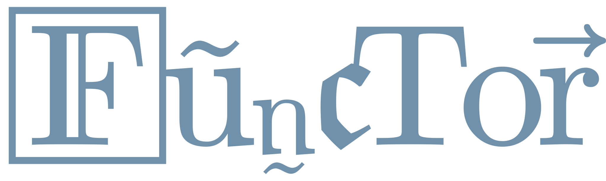
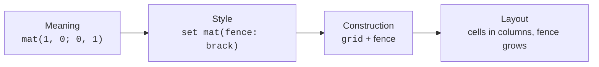
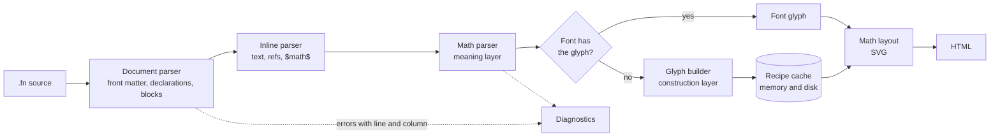

<p align="center"></p>

# Functor

Functor is a typesetting language for mathematics. It builds symbols from a small grammar. You do not memorise a long list of commands.

```text
$$
sum.circle_(k = 1)^n a_k = integral.x2_D f d x d y,   x in.not A,   theta.hat
$$
```

`sum.circle` is a sum in a circle. `in.not` is "not in". `theta.hat` is an estimate of theta. One base, then short operations.

## Status

Version 0.1.0 is a pre-release. The language still changes, so old files can stop working in a new version.

Download the command line tool, the desktop app and the Chrome extension from [Releases](https://github.com/eleadlau-commits/Functor/releases). Or use the [website](https://eleadlau-commits.github.io/Functor/) with no install.

## Use the website

The website has an editor at the left and a live preview at the right. It runs the compiler in your browser as WebAssembly. No server is necessary.

- Type in the editor. The preview changes at each key. Only the blocks that you change are compiled and drawn again, and the compiler runs in a background worker, so long notes stay fast.
- Errors show in the editor and in the problem list. Click a problem to go to its line.
- Double-click a word or math in the preview to go to it in the source. Press `Alt+Enter`, or click **Locate**, to find the cursor's place in the preview.
- Type `.` after a symbol in math to see the operations. Each one shows its meaning and a preview of the glyph.
- A wavy line marks a word that is not in the dictionary. Only prose is checked: math, code, labels, references and declarations are not. Right-click the word, or press Ctrl+. (Cmd+. on a Mac), for suggestions and **Add to my word list**. Alt+F7 goes to the next word. **Spelling** turns the check on or off, sets UK or US English, and shows your word list.
- **+** opens a new tab. The browser keeps your tabs and their text.
- **Save .fn** downloads your file. **Open** loads a file. **HTML** downloads the compiled page. **PDF** downloads a PDF that Functor sets itself. **Print** opens the print dialog.
- The website keeps your last file in this browser.

Run it on your computer:

```sh
rustup target add wasm32-unknown-unknown
cd web
npm install
npm run dev
```

## Use the desktop app

The desktop app is the same editor in a native window. The compiler runs as native Rust, not WebAssembly.

```text
 .fn file on disk ──► editor (web/) ──► functor-paper (native) ──► preview
        ▲                                       │
        └────────── watch: reload on change ◄──┘
```

- Each file opens in its own tab. Each tab keeps its text, undo history, cursor, scroll and preview. A dot on a tab shows changes that are not saved.
- **Open** (Ctrl+O) opens one or more `.fn` files in new tabs. A file that is already open gets its tab shown. **Save** (Ctrl+S) writes the current tab. Shift+Save is "Save as".
- When another program changes an open file, the app loads the new text into its tab. It does not do this when the tab has unsaved changes.
- The app opens your tabs from the last session at start, with unsaved text. You can also give a path: `functor-desktop notes.fn`.

| Keys (Cmd on macOS) | Action |
|---|---|
| Ctrl+T, or **New** | New tab |
| Ctrl+W, or middle-click | Close tab. The app asks first if the tab has unsaved changes |
| Ctrl+Tab, Ctrl+Shift+Tab | Next tab, previous tab |
| Ctrl+1 … Ctrl+8, Ctrl+9 | Go to tab 1 … 8, go to the last tab |
| Drag a tab | Change the order |
- It works with no network.

Run it on your computer (Linux needs `libwebkit2gtk-4.1-dev`):

```sh
rustup target add wasm32-unknown-unknown
(cd web && npm install)
cd desktop
npm install
npm run dev
```

`npm run build` makes an installer in `desktop/target/release/bundle`. The **Desktop** workflow on GitHub makes installers for Linux, macOS and Windows.

## Use Functor in Claude chats

The browser extension in [`extension/`](extension/README.md) shows `fn` code blocks in claude.ai chats as typeset math. It runs the WebAssembly compiler in the browser. The **Browser extension** workflow on GitHub builds it as the `functor-extension` artifact. Load it with **Load unpacked** in `chrome://extensions`.

## Use Functor on web pages

[`functor.js`](js/README.md) typesets Functor on any web page and in Claude artifacts, like KaTeX auto-render. Add one line, then write `<fn-math>x^2</fn-math>`:

```html
<script src="https://cdn.jsdelivr.net/npm/functor-js@0.1.0/functor.js"></script>
```

It also renders Markdown `fn` code blocks and `fn:` inline code. The Chrome extension uses the same code. See the [demo](https://eleadlau-commits.github.io/Functor/js/demo/) and [Math on web pages](docs/reference/help/web.fn).

## Reference

The language reference is at [eleadlau-commits.github.io/Functor/reference](https://eleadlau-commits.github.io/Functor/reference/). It has one page for each construct and each operation.

- The [cheat sheet](docs/reference/cheatsheet.fn) is the whole language on one page. Give it to an AI model that does not know Functor. Its "Short version for instructions" block fits in Claude project instructions.
- The [LaTeX map](docs/reference/latex.fn) gives the Functor form for each LaTeX command.
- `reference/llms.txt` on the site lists each page as raw `.fn`.

The pages are Functor files in [`docs/reference`](docs/reference). The compiler makes the pages in `docs/reference/gen` from its own tables. Tests compile each page and each example, and fail when a generated page is old or a construct has no page.

```sh
cargo run -p functor-cli -- ref gen
cargo run -p functor-cli -- ref build site/reference
```

## Use the command line

```sh
cargo run -p functor-cli -- compile examples/sample.fn
cargo run -p functor-cli -- check examples/sample.fn
cargo run -p functor-cli -- pdf examples/sample.fn
cargo run -p functor-cli -- glyph sum.circle > sum-circle.svg
cargo run --release -p functor-cli -- bench examples/sample.fn
```

`check` writes each problem as `file:line:col: error: message`, with a hint below it.

Built glyphs go into a disk cache, so the next run does not build them again. The cache is in `FUNCTOR_CACHE_DIR`, or in your user cache folder. Use `--no-cache` to turn it off.

## The language in one page

```text
---
functor: 1
title: Notes on fields
author: E
---

object vec: F, v
sym csum = sum.circle
set vec(style: arrow)
let n = 3

# Fields {#sec:fields}

A force $F = m a$ acts on {n} bodies. See @eq:work.

$$
W = csum_C F cdot d r
$$ {#eq:work}

::: theorem {#thm:main title="Closed work"}
If $F = nabla phi$, then $W = 0$.
:::

::: proof
Use @eq:work.
:::
```

| Part | Form | Result |
|:--|:--|:--|
| Version | `functor: 1` in the front matter | The compiler knows which language rules to use |
| Heading | `# Text {#label}` | Numbered heading |
| Inline math | `$x.hat$` | Math in the line |
| Display math | `$$ ... $$ {#eq:name}` | Numbered equation |
| Reference | `@eq:name` | "(1)", "Theorem 2", "Section 3" |
| Block | `::: theorem {#thm:a title="..."}` ... `:::` | theorem, lemma, corollary, proposition, definition, example, remark, proof, note, figure, quote |
| Object | `object vec: F, v` | `F` and `v` are vectors. Their look comes from `set vec(...)` |
| Symbol | `sym csum = sum.circle` | A short name for a recipe |
| Value | `let n = 3`, then `{n}` in text | Text replacement |
| Punctuation | `"text"`, `'text'`, `--`, `---`, `Theorem~2` | Curly quotes, en dash, em dash, a space that does not break. `\"`, `\'`, `\-`, `\~` give the plain sign |
| Setting | `set page(size: a4)`, `set text(size: 11pt)`, `set heading(numbering: none)` | Document settings |
| Note | `text.^[A note with $x^2$.]` | A numbered note. In `quiet` it sits in the right margin, next to its line, and folds into the text on narrow screens. In `classic` it follows the paragraph |
| Document style | `set document(style: quiet)`, `set document(style: classic, accent: #4a6a85)` | The look of the whole page. `quiet` is the default: left title, numbers in the margin, upright theorems with a rule. `classic` is the LaTeX article look |

Functor sets each paragraph itself, as TeX does. It shapes words with the font (kerning and ligatures), finds hyphenation points with TeX patterns, and picks the line breaks for the whole paragraph with the Knuth-Plass method. Inline math can break after `=`, `<` or `+`. The preview breaks lines again when its width changes. HTML exports and the CLI use the text width of the page (`set page(size, margin)`).

`functor pdf` and the PDF button set whole pages, as TeX does. A page builder puts lines, headings, display math, tables and lists on pages. It avoids a single line of a paragraph at the top or bottom of a page, and it never leaves a heading at the bottom of a page. The PDF embeds the Latin Modern fonts, so text can be selected and searched. Math is drawn with the same glyph recipes as the preview.

Math uses names, not backslashes: `alpha`, `sum`, `integral`, `in`, `to`, `infty`. Groups use round brackets: `x_(i + 1)`, `frac(a, b)`, `sqrt(x)`. Spaces separate symbols: `d x` is two symbols. `thin`, `med`, `thick` and `quad` add space, and `neg` takes back one twelfth of an em. `join(a, b)` sets two symbols so that they touch and become one glyph, for example `join(o.up, r.up)`.

## Structures

A matrix, a vector and cases are grids in a fence. In a grid, a comma ends a cell and a semicolon ends a row. New lines are free space.

```text
mat(1, 0; 0, 1)            matrix
vec(1, 2, 3)               vector with components (vec(x) is still a named vector)
cases(x, x ge 0; -x, x lt 0)
binom(n, k)   abs(x)   norm(v)   inner(u, v)   floor(x)   ceil(x)
grid(a, b; c, d)           a grid with no fence
```



The look comes from one rule for each kind, not from the source:

| Rule | Options |
|:--|:--|
| `set mat(...)`, `set binom(...)`, `set abs(...)`, `set norm(...)`, `set inner(...)`, `set floor(...)`, `set ceil(...)` | `fence`, `grow` |
| `set vec(...)` | `style` (named vectors: `arrow`, `bold`), `fence`, `body` (`column`, `row`), `grow` |
| `set cases(...)` | `fence`, `word` (for example `"if"`), `grow` |
| `set wrap(...)` | `grow` (`stretch` or `magnify`) |

A `fence` value is a fence operation (`brack`, `vbar.x2`, `brace.left`), `none`, or any one symbol, for example a `sym`.

**Fences are operations.** `(a + b).angle` gives ⟨a + b⟩. `x2` doubles a fence: `(v).vbar.x2` gives ‖v‖ and `(M).brack.x2` gives ⟦M⟧. `left` and `right` keep one side: `(x).brace.left`.

**Any glyph can be a fence.** `wrap(L.script, x + y)` puts L at the left and L turned left to right at the right. `wrap(T.frak, S.frak, a)` gives two different sides. The fence grows with the content: `stretch` deforms the glyph, so the straight parts grow and the ends and thin strokes keep their shape. `magnify` makes the whole glyph larger.

**Aligned equations.** In display math, a new line starts a new row. The rows align at the first relation. A line that starts with a relation continues the left side. New lines inside brackets do not start a row.

```text
$$
(a + b)^2 = (a + b)(a + b)
          = a^2 + 2 a b + b^2
$$ {#eq:square}
```

## Symbol operations

A recipe is a base and up to three operations: `base.op1.op2.op3`. Operations also work on a group: `(F_T).box` boxes F with its index. More than three gives a warning, because the symbol becomes hard to read.

| Operation | Layer | Meaning |
|:--|:--|:--|
| `hat` | decorate | a derived object, often an estimate |
| `tilde` | decorate | a related object, often an approximation |
| `bar` | decorate | a derived object, often a mean or conjugate |
| `dot` | decorate | a first derivative in time |
| `ddot` | decorate | a second derivative in time |
| `check` | decorate | a dual or inverse object |
| `breve` | decorate | a related object |
| `arrow` | decorate | a vector |
| `under` | decorate | a related object |
| `circle` | enclose | a closed or restricted version |
| `box` | enclose | a restricted or boxed version |
| `square` | enclose | a boxed version with equal sides |
| `not` | strike | negation |
| `cross` | strike | a fixed variant |
| `x2` | repeat | second order |
| `x3` | repeat | third order |
| `x4` | repeat | fourth order |
| `flip` | reflect | a dual or opposite |
| `flipv` | reflect | a dual or opposite |
| `turn` | reflect | a dual or opposite |
| `bold` | style | a new kind of object, often a vector |
| `bb` | style | a number set |
| `frak` | style | an ideal, an algebra or a structure |
| `script` | style | a family, a category or a transform |
| `up` | style | a constant, a unit or a name |
| `small` | magnify | a smaller version, about four fifths |
| `tall` | deform | a taller version; the straight parts grow and the ends keep their shape |
| `wide` | deform | a wider version, such as a long arrow; the ends keep their shape |
| `paren` | fence | round brackets, a group or a tuple |
| `brack` | fence | square brackets, a group or a matrix |
| `brace` | fence | curly brackets, a set |
| `angle` | fence | angle brackets, a pairing or an average |
| `vbar` | fence | bars, a size or a determinant |
| `floor` | fence | round down |
| `ceil` | fence | round up |

When the font has the result, the compiler uses the font glyph. `integral.circle` gives ∮, `in.not` gives ∉ and `E.flip` gives ∃. When the font does not have it, the compiler builds the glyph and keeps it in a cache.

## Logo

The logo is written in Functor. The mark is the recipe `F.bb.arrow`. The wordmark is one line of math:

```text
F.bb.square neg u.up.tilde_(neg u.up.tilde.turn) neg c.frak neg neg T.up neg join(o.up, r.up.arrow)
```

The n is the u turned half a circle, so n is the dual of u. The colour is `#7091AC`. Run `scripts/build-logo.sh` to build the SVG files in `docs/logo/` again.

## How it works



The four layers are in [docs/PHILOSOPHY.md](docs/PHILOSOPHY.md).

| Crate | Job |
|:--|:--|
```text
 functor-symbols   names, recipes, deform, glyph builder, glyph cache
        ▲
 functor-math      formula layout (sums, fractions, grids, fences, diagrams)
        ▲
 functor-paper     parser, text, line breaking, pages, HTML, PDF, reference
        ▲
 functor-wasm · functor-cli · desktop
```

| Crate | Job |
|:--|:--|
| `functor-symbols` | Symbol engine: names, recipes, deform, glyph builder. Knows nothing about documents. |
| `functor-math` | Formula layout. Uses only `functor-symbols`. |
| `functor-paper` | Document engine: parser, text, pages, HTML, PDF |
| `functor-wasm` | WebAssembly functions for the website |
| `functor-cli` | The `functor` command |

Dependencies go one way only, down the list. A later `functor-proof` engine (Lean, issue #21) will use `functor-math`, not `functor-paper`.

`functor-symbols` and `functor-math` have no outside dependencies.

## Speed

Phase 0 gate, from `functor bench` in a cloud container on 24 November 2026:

| Test | Gate | Result |
|:--|:--|:--|
| Build one new glyph, worst of 50 | < 5 ms | 0.42 ms |
| Compile `examples/sample.fn`, first run | < 100 ms | 0.63 ms |

## Licence

The code is MIT. The glyph outlines come from New Computer Modern through MathJax, under the Apache 2.0 licence. See [NOTICE](NOTICE).
