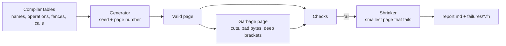

# functor-stress

This crate makes random Functor pages and checks the compiler on each page. It uses code, not an AI model, so a run of 10,000 pages costs no tokens.



## Run it

```text
cargo run --release -p functor-stress -- run --pages 10000
cargo run --release -p functor-stress -- page --seed 1 --index 42
cargo run --release -p functor-stress -- check file.fn
cargo run --release -p functor-stress -- sheet --seed 7 --count 50
cargo run --release -p functor-stress -- census
```

The same seed and page number always give the same page. Use `page` to see a page from a report.

## Checks

| Check | Valid pages | Garbage pages |
|:--|:-:|:-:|
| No crash, no hang (each page runs in a child process with a 1 MB stack, as in the browser) | yes | yes |
| No error | yes | |
| Each message has a line and a column in the file | yes | yes |
| No `NaN` or `inf` in the SVG, no empty formula | yes | yes |
| The same output on the second run, and after the disk cache | yes | yes |
| The PDF has a good cross-reference table and pages | each 4th page | each 4th page |
| No two parts touch: base and scripts, fraction parts, root, fences, cells, neighbours, arrow labels | yes | |

`census` builds each name with each operation and checks that it has ink.

## Known failures

`known.txt` holds the failures that are known. A known failure does not fail CI. When you fix a bug, remove its lines from `known.txt` and put the smallest case in `regressions/`. A file name that starts with `garbage-` is checked as garbage. All other files must compile with no error.

## CI

`.github/workflows/stress.yml` runs 10,000 pages with seed 1 on each pull request. Each Monday it runs 50,000 pages with a new seed and makes a contact sheet of 50 random formulas for a person to look at. The report is in the job summary and in the artifact.
