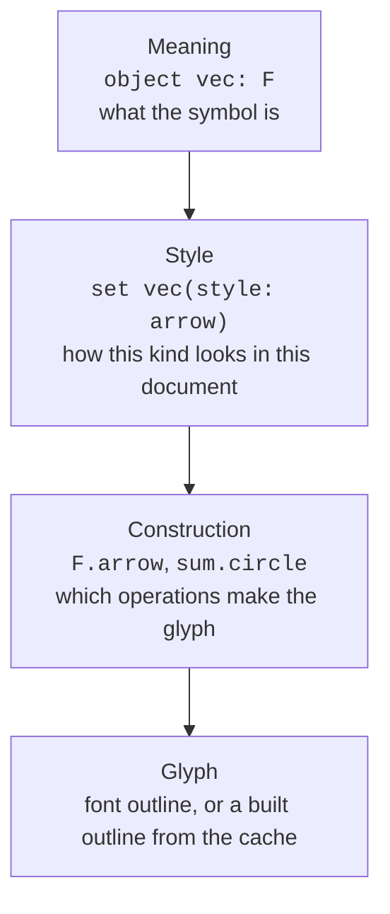
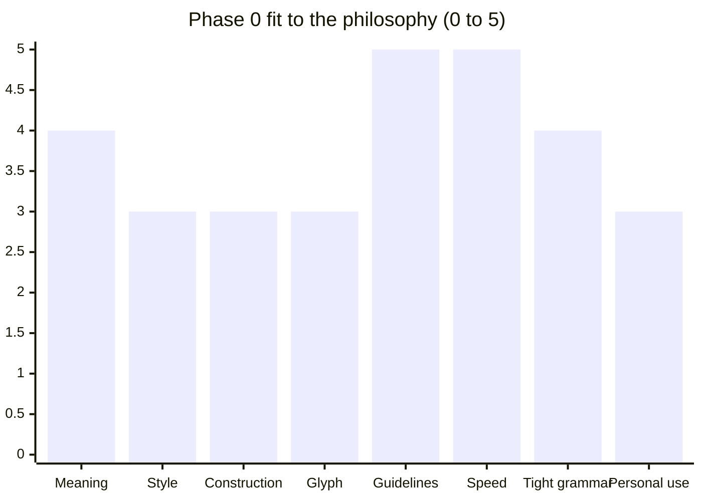
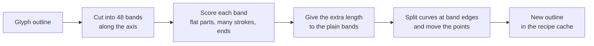

# Symbol philosophy

Functor builds a symbol in four layers. Each layer has one job.

1. **Meaning.** You say what an object is. `object vec: F` says that `F` is a vector.
2. **Style.** One rule sets how a kind of object looks. `set vec(style: bold)` changes every vector in the document.
3. **Construction.** A recipe is a base and short operations: `theta.hat`, `in.not`, `integral.x2`. Each operation has one meaning.
4. **Glyph.** The compiler uses the font glyph when the font has it. If not, it builds the glyph from the recipe and keeps it in a cache.

## Rules

These are guidelines. The compiler gives a warning, not an error, when you go against one.

- Use at most three operations on one symbol. If you need more, define a `sym` with a clear name.
- Use the operation whose meaning fits. `hat` is a derived object, `tilde` is a related object, `not` is negation.
- Put meaning in the source and style in one rule. Do not write `F.arrow` in each place. Write `object vec: F` once.
- `deform` is the most general operation. In version 1 it changes existing symbols only. Phase 1 has the first kind: grow along one axis.
- Speed is part of the design. The compiler builds glyphs at compile time and keeps each recipe in a cache.

## Priorities

1. The glyph-building philosophy comes first.
2. No LaTeX compatibility. A tight and systematic symbol grammar. Good documentation and AI conversion help people move from LaTeX.
3. Personal use first. A possible link with Träumerei later.

## Phase 0 scorecard

Each line has a score from 0 to 5. 5 means that phase 0 does all that the principle asks for.

| Principle | Score | What phase 0 does | Gap |
|:--|:-:|:--|:--|
| Meaning layer | 4 | `object vec:` declares meaning. Each operation has one written meaning, and the editor shows it. | `vec` is the only kind. Own kinds come in phase 1. |
| Style layer | 3 | `set vec(style: arrow\|bold)` changes all vectors from one rule. | `bold`, `bb`, `frak`, `script` and `up` are still operations in the recipe, so style and construction mix there. |
| Construction layer | 3 | 33 operations in 8 families: decorate, enclose, strike, repeat, reflect, style, magnify, fence. Operations work on a single symbol or on a group. `join(a, b)` makes one glyph from two symbols. | `deform`, `fuse` and `stretch` are not there yet. The compiler refuses them with a clear message. |
| Glyph layer | 3 | Font glyph first (∮, ∉, ∃, ∀, ħ). Other recipes are built and cached. | Built strokes have one fixed weight. They do not follow the weight of the font, and enclosures are tight on large operators. |
| Guidelines, not rules | 5 | More than three operations gives a warning. Unknown words give a warning with a hint. | None. |
| Speed | 5 | Worst new glyph 0.42 ms (gate 5 ms). Sample document 0.63 ms (gate 100 ms). | None. |
| Tight grammar | 4 | Short names only. No backslashes. Each error has a line, a column and a "Did you mean" hint. | `{n}` values do not work in math yet. |
| Personal use | 3 | The website runs in the browser with no server and keeps your file. Print to PDF works. | No Träumerei link yet. No page breaks for print. |

Total: 30 of 40.

## Structures scorecard

Matrices, vectors, cases and aligned equations use the same four layers as symbols. Before this change they scored 3 of 20. Each layer has a score from 0 to 5.

| Layer | Before | Now | What it does now | Gap |
|:--|:-:|:-:|:--|:--|
| Meaning | 1 | 4 | Kinds: `mat`, `vec`, `cases`, `binom`, `abs`, `norm`, `inner`, `floor`, `ceil`. | Own kinds wait for `kind` in phase 1. |
| Style | 1 | 4 | One rule for each kind: `fence`, `grow`, `body`, `word`. A fence can be any symbol. | Named matrices (`object mat: A`) have no style yet. |
| Construction | 0 | 4 | One `grid`. Fences are an operation family on any group, and `x2` doubles them. `wrap` takes any glyph. | The align point of a chain is always the first relation. |
| Layout | 1 | 4 | Columns, rows and fences that grow. Since phase 1, `stretch` uses `deform`, so thin strokes stay thin. | The align point of a chain is always the first relation. |

Total: 16 of 20 (15 before phase 1 deform).

### Decision: Functor draws its own math

The plan said that phase 0 would use browser MathML. Phase 0 draws math as SVG with its own layout instead. MathML can show only glyphs that are in a font. A built glyph such as `nabla.circle` has no code point, so MathML cannot show it. Own layout makes built glyphs equal to font glyphs. This fits priority 1.

### Key hiccups

- The font data from MathJax has no move command at the start of each path. Browsers did not draw the glyphs. The extractor now adds it.
- The double-struck letters (ℝ, ℕ) are in a separate table in the font package. The extractor now reads it.
- The first "Did you mean" check counted a swap of two letters as two changes. `alpah` got no hint. The check now counts a swap as one change.
- The proxy blocks jsDelivr and GitHub raw files. The font data comes from npm.

## Phase 1 deform

`deform` changes the outline of an existing glyph. Version 1 has one kind: grow along one axis. It moves points and keeps the parts that have detail.

- A band with flat parts (serifs, the ends of a bracket, the tip of a brace) keeps its size.
- A band with more strokes than the plainest band (the loop of a script L) keeps its size.
- The 22% at each end of the glyph grows less, so terminals keep their shape.
- Each curve is split where it crosses a band edge. In one band the move is a plain scale, so the curve stays exact.

Where it is used:

- `tall` and `wide` are deform operations. `to.wide` is a long arrow.
- Fences with `grow: stretch` (the default) and the radical use deform. Only one fifth of the growth (as a power) is magnify, so large fences get a little heavier, as in good print.
- The cache key is the glyph and the size rounded up to 2%. Similar heights share one glyph.

| Principle | Score | What phase 1 deform does | Gap |
|:--|:-:|:--|:--|
| Deform is the most general operation | 3 | One kind of deform with two operations and the fence growth. | No bend, slant or taper yet. No deform on a group. |
| Existing symbols only (v1) | 5 | Deform takes any glyph: font, built or styled. | None. |
| Construction layer | 4 | 35 operations in 9 families. | `fuse` is not there yet. |
| Glyph layer | 4 | Stretched fences and letters keep their stroke weight. | The rule of a radical has a fixed weight. |
| Speed | 5 | About 0.2 ms for each new deformed glyph. Sample document: first compile 3.6 ms (was 1.6 ms), warm 0.9 ms. Gate 100 ms. | None. |

### Key hiccups

- Font outlines have no close command. The open end made a straight edge that did not follow the bands, so `⟩` was lopsided. Deform now closes each outline first.
- The loop of a script L has near vertical sides, so the first version stretched the loop. A count of strokes in each band fixed it.
