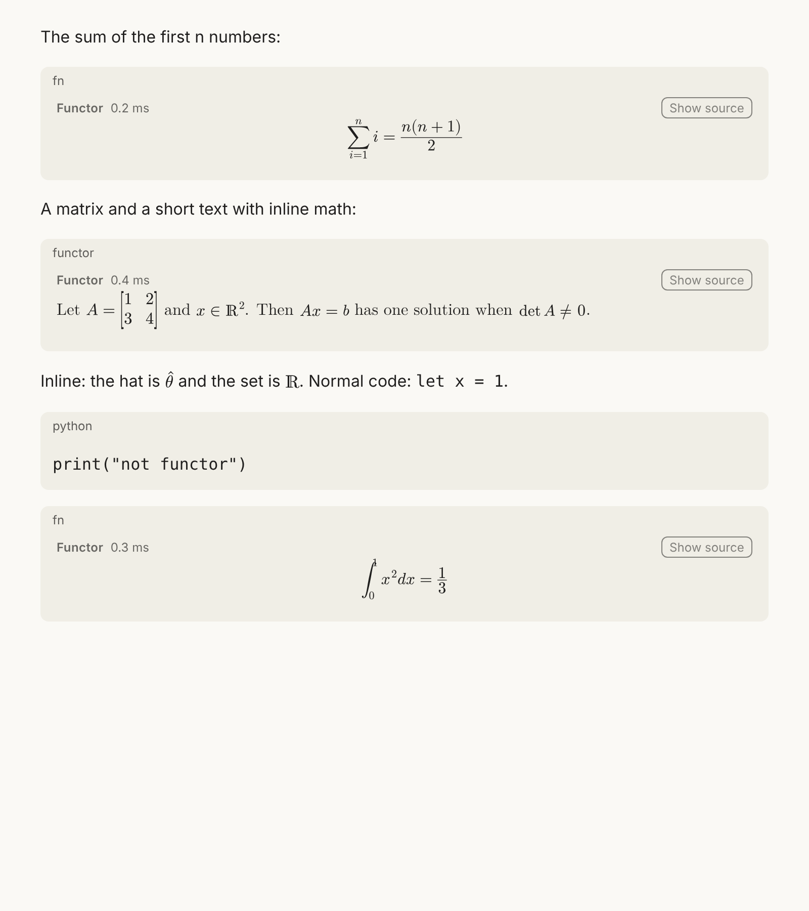

# Functor in Claude

A Chrome extension. It shows Functor code blocks in Claude chats (claude.ai) as typeset math. The Functor compiler runs inside the extension as WebAssembly. Nothing goes to a server.



## Install

1. Get the extension folder:
   - From CI: open the latest **Browser extension** run in the Actions tab, download the `functor-extension` artifact, and unzip it.
   - Or build it: `node scripts/build-extension.mjs` (needs Rust with the `wasm32-unknown-unknown` target). The result is in `extension/dist`.
2. Open `chrome://extensions` and turn on **Developer mode**.
3. Click **Load unpacked** and select the folder.
4. Reload the claude.ai tab.

To update, replace the folder and click the reload arrow on the extension card.

## Use

| You write | You see |
|:--|:--|
| a code block with the language `fn` or `functor` | a rendered block |
| a code block with the language `fnmath` | display math, always |
| inline code that starts with `fn:`, for example `` `fn: theta.hat` `` | inline math |

A `fn` block with no `$` and no heading is display math. A `fn` block with `$` is a small document: text with inline and display math. Lines at the top that start with `set`, `sym`, `object`, `let` or `use` stay as rules. The extension adds the `functor: 1` header when the block has none.

Each block has a **Show source** button. The toolbar icon turns the extension off and on for all tabs.

## Ask Claude to write Functor

Claude does not know Functor. Put a short note in your Claude project instructions or your profile preferences, for example:

```text
When you write math, use Functor (github.com/eleadlau-commits/Functor), not LaTeX.
Put display math in a ```fn code block and inline math in inline code that starts with "fn: ".
Functor names: alpha, sum, integral, in, to, infty; groups use round brackets:
x_(i + 1), frac(a, b), sqrt(x). Operations follow a dot: theta.hat, R.bb, in.not, eq.not.
Matrices: mat(1, 2; 3, 4). Vectors: vec(1, 2, 3). Cases: cases(x, x ge 0; -x, x lt 0).
```

## Limits

- Other people see the rendered math only when they also have the extension.
- The extension reads the page structure of claude.ai. When claude.ai changes its code blocks, the extension can stop finding them.
- Chrome and other Chromium browsers only for now.

## Test

`node scripts/extension-smoke.mjs` loads the built extension in Chromium on a copy of a chat page and checks the result. Set `SHOTS=dir` for a screenshot and `DARK=1` for dark mode.
